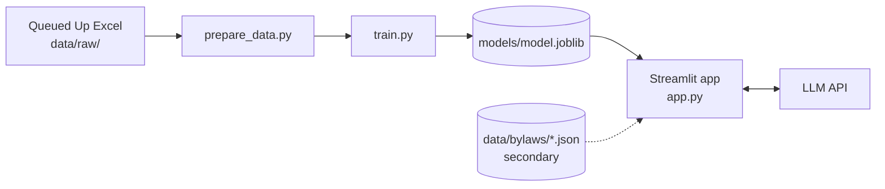

# Design Document

## Overview

Queue Odds is a single Streamlit app backed by a model trained offline. A training script turns Berkeley Lab's Queued Up data into a classifier. The app loads the saved model, maps active ISO-NE projects by predicted odds, and explains each prediction with SHAP factors that an LLM turns into plain English. A secondary bylaw reader shows local zoning rules for 3 Massachusetts towns.

It is built solo in one day, so the design keeps moving parts to a minimum: one app, no separate API, no database.

## Architecture



Training runs once offline. The app never retrains; it only loads the saved model and the processed tables.

## Project structure

```text
queue-odds/
├── app.py                 # Streamlit app: map, detail panel, what-if
├── src/
│   ├── prepare_data.py    # load Excel, build training and active tables
│   ├── train.py           # train, evaluate, save model and metrics
│   ├── explain.py         # prediction, SHAP top factors, LLM explanation
│   ├── similar.py         # nearest resolved projects
│   └── bylaws.py          # secondary: extract and load bylaw rules
├── data/
│   ├── raw/               # Queued Up Excel file (gitignored)
│   ├── processed/         # training.csv, active_isone.csv
│   ├── geo/               # Census county centroids
│   └── bylaws/            # bylaw PDFs and extracted JSON
├── models/                # model.joblib, metrics.json
├── docs/                  # DECISIONS.md, CHANGELOG.md, WRITEUP.md, DEMO.md
├── requirements.txt
├── .env                   # LLM API key (gitignored)
└── README.md
```

## Data

Source: [Berkeley Lab Queued Up 2026 Edition](https://emp.lbl.gov/queues), project-level queue data through 2025, licensed CC BY 4.0. Credit Lawrence Berkeley National Laboratory and GridTracker.

The column names below are descriptive. Map them to the real names in the file's codebook tab, and confirm the mapping with the human before training.

| Item | Rule |
| --- | --- |
| Label | Reached operation = 1; withdrawn = 0 |
| Excluded rows | Active and suspended projects (no outcome yet) |
| Features | ISO or region, state, technology type, capacity (MW), queue entry year, paired with storage (yes/no) |
| Excluded columns | Withdrawal date, operation date, interconnection agreement status, and anything else recorded after queue entry |
| Split | Train on older queue entry years; test on the most recent years that have outcomes |
| App table | Active ISO-NE projects, scored by the model |
| Location | Use coordinates if the file has them; otherwise the county centroid from the Census county Gazetteer file |

Encode categorical features (OrdinalEncoder or one-hot) before training so SHAP's TreeExplainer can read the model.

## Components and Interfaces

These signatures are a starting point. Kiro may change them and log why in docs/DECISIONS.md.

- `src/prepare_data.py`
  - `load_queue(path) -> DataFrame`
  - `build_training_table(df) -> DataFrame`: features, label and queue entry year for resolved projects
  - `build_active_table(df) -> DataFrame`: active ISO-NE projects with latitude and longitude
- `src/train.py`
  - `train(df) -> (model, metrics)`: time split, fit, AUC; writes models/model.joblib and models/metrics.json
- `src/explain.py`
  - `predict(model, row) -> float`
  - `top_factors(model, row, k=3) -> list[dict]`: keys `feature`, `value`, `shap`, `direction`
  - `explain_text(probability, factors) -> str`: calls the LLM; returns a plain list of factors on error
- `src/similar.py`
  - `similar_projects(row, resolved_df, k=5) -> DataFrame`: same region and technology, then sorted by size ratio and queue-year gap
- `src/bylaws.py` (secondary)
  - `extract_rules(pdf_path) -> dict`: writes data/bylaws/<town>.json
  - `load_rules(town) -> dict | None`
- `app.py`
  - Map with streamlit-folium, markers colored by probability; a project dropdown as fallback if click handling is unreliable
  - Detail panel: probability, explanation, withdrawal-cause note, what-if controls, similar projects, bylaw section
  - Footer: data credit

### Explanation prompt

```text
You explain a machine learning model's prediction for a proposed power project
waiting to connect to the grid.

Use ONLY the factors listed below. Do not add other reasons, facts or advice.

Predicted probability of reaching operation: {probability}
Top factors (feature, value, effect on odds):
1. {feature_1} = {value_1}: {direction_1}
2. {feature_2} = {value_2}: {direction_2}
3. {feature_3} = {value_3}: {direction_3}

Write 2-3 plain sentences for a non-expert.
```

## Bylaw reader (secondary)

Context: Massachusetts towns had to start accepting consolidated local permit applications for small clean energy projects (under 25 MW generation, under 100 MWh storage) by October 1, 2026 ([source](https://www.nutter.com/trending-newsroom-publications-environment-energy-insights-june-2026)). Larger projects go to the state Energy Facilities Siting Board, so this panel matters most for small projects.

Scope: 3 Massachusetts towns with active ISO-NE projects. The human collects the PDFs and checks every extracted field. The rules are shown beside the prediction and are not used as model features.

### Extraction prompt

```text
From the bylaw text below, extract the fields in the JSON schema for solar and
battery storage.

For every field, copy the exact supporting passage into "quote" and give its
section number. If the text does not address a field, set its value to
"not_found" and leave quote and section as null. Never infer a rule that is
not stated.
```

### Output schema (one file per town)

`status` is one of `by_right`, `special_permit`, `prohibited` or `not_found`. `battery_storage` has the same fields as `solar`.

```json
{
  "town": "Example Town",
  "source": "Zoning Bylaw, as amended May 2025",
  "rules": {
    "solar": {
      "use_status": [
        {"zone": "Industrial", "status": "by_right", "quote": "...", "section": "5.3.2"}
      ],
      "setbacks": {"value": "...", "quote": "...", "section": "..."},
      "size_cap": {"value": "not_found", "quote": null, "section": null},
      "moratorium": {"value": "not_found", "quote": null, "section": null},
      "decommissioning_bond": {"value": "...", "quote": "...", "section": "..."}
    },
    "battery_storage": {
      "use_status": [],
      "setbacks": {"value": "not_found", "quote": null, "section": null},
      "size_cap": {"value": "not_found", "quote": null, "section": null},
      "moratorium": {"value": "not_found", "quote": null, "section": null},
      "decommissioning_bond": {"value": "not_found", "quote": null, "section": null}
    }
  }
}
```

## Error Handling

| Situation | Behavior |
| --- | --- |
| LLM call fails or times out | Show the top 3 factors as a plain list |
| Project has no coordinates or county | Leave it off the map; show a count of omitted projects |
| Model file missing | Show a message to run src/train.py |
| SHAP TreeExplainer rejects the model | Use shap.Explainer on predict_proba with a background sample of 100 training rows |
| Town not covered by the bylaw reader | Show "Local rules not available for this town" |
| Bylaw field not in the text | Show "not found" |

## Testing Strategy

- Assert that no excluded column appears in the feature list.
- Print the class balance and test AUC. An AUC near 0.5 means something is wrong.
- Spot-check 2–3 showcase projects in the app: probability, explanation, what-if and similar projects all load.
- Bylaw reader: the human checks every extracted field against its quote before it appears in the demo.

## Demo flow (3 minutes)

1. Problem: 61 months in the queue, and only about 10% of projects make it.
2. Open the map of active ISO-NE projects colored by odds.
3. Click a low-odds project: show its probability and plain-English reasons.
4. What-if: add storage or change the size and watch the odds move.
5. Show similar past projects that withdrew.
6. If built: show the town's bylaw panel with the quoted rules that apply.
7. Close: free, open and explains itself, unlike paywalled scores.

## Known limits

- The label mixes causes: a withdrawal may come from interconnection cost, permitting or financing, and the data doesn't say which.
- Recent projects are mostly unresolved, so the model learns mostly from older queue rules.
- Most projects fail, so report AUC rather than accuracy, and expect it to be modest.
- SHAP shows what correlates with outcomes, not what causes them.
- The bylaw reader covers only the hand-picked towns, and its fields are only as reliable as the manual check.

## Sources

- [Berkeley Lab, Queued Up](https://emp.lbl.gov/queues)
- [Axis Intelligence, grid interconnection queue statistics](https://axis-intelligence.com/grid-interconnection-queue-statistics/) (61-month median, citing Queued Up 2026)
- [POWER Magazine, Enverus 2025 Interconnection Queue Outlook](https://www.powermag.com/enverus-releases-2025-interconnection-queue-outlook) (about 10% expected online within three years)
- [Nutter, Massachusetts small clean energy siting regulations](https://www.nutter.com/trending-newsroom-publications-environment-energy-insights-june-2026)
