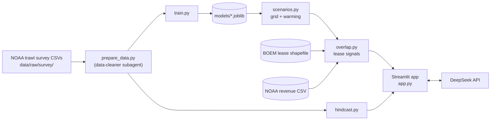

# Design Document

## Overview

Shifting Grounds trains one habitat model per species on NOAA's fall bottom trawl survey, using bottom temperature and depth. It re-predicts habitat on a grid under +1°C and +2°C warming, measures how habitat inside each active offshore wind lease changes, and labels the change as a planning signal. A Streamlit app shows the map, the signals, NOAA revenue context, a hindcast check, and plain-English briefs written by DeepSeek.

It is built solo in one day, so the design keeps moving parts to a minimum: one app, no separate API, no database.

## Architecture



Everything up to `overlap.py` runs offline and writes files to data/processed/. The app only reads those files and calls DeepSeek.

## Implementation notes

- **Haiku subagents for data cleaning.** Data-cleaning work (task 2 and the revenue cleanup in task 6) is delegated to the `data-cleaner` subagent in .kiro/agents/data-cleaner.json, which runs on Claude Haiku. Check the exact Haiku model ID with `/model` in Kiro and update the agent file if it differs. If Kiro doesn't pick up the agent, switch the chat model to Haiku with `/model` for those tasks instead. The main agent reviews the subagent's output (row counts, presence rates, tows per year) before anything is built on it.
- **DeepSeek for the writeups.** Briefs use the DeepSeek API. The key is in .env as `DEEPSEEK_API_KEY`. The model name is read from `DEEPSEEK_MODEL`, defaulting to `deepseek-flash`, the current name in DeepSeek's docs. DeepSeek's API is OpenAI-compatible:

```python
import os
from openai import OpenAI

client = OpenAI(api_key=os.environ["DEEPSEEK_API_KEY"], base_url="https://api.deepseek.com")
response = client.chat.completions.create(
    model=os.environ.get("DEEPSEEK_MODEL", "deepseek-flash"),
    messages=[{"role": "user", "content": prompt}],
)
brief = response.choices[0].message.content
```

## Project structure

```text
shifting-grounds/
├── app.py                 # Streamlit app: map, selectors, lease panel, hindcast
├── src/
│   ├── prepare_data.py    # load survey CSVs, zero-fill presence table
│   ├── train.py           # one model per species, AUC, save models
│   ├── hindcast.py        # predicted vs observed shift
│   ├── scenarios.py       # recent-conditions grid, +0/+1/+2°C predictions
│   ├── overlap.py         # lease overlap, signals, revenue join
│   └── explain.py         # SHAP temperature response, DeepSeek briefs
├── data/
│   ├── raw/               # gitignored
│   │   ├── survey/        # NOAA fall survey zip contents + support tables
│   │   ├── boem/          # lease area shapefile
│   │   └── revenue/       # NOAA wind area landings and value CSV
│   └── processed/         # tows.csv, presence.csv, grid_predictions.csv, lease_signals.csv, hindcast.csv
├── models/                # <species>.joblib, metrics.json
├── docs/                  # DECISIONS.md, CHANGELOG.md, WRITEUP.md, DEMO.md
├── .kiro/agents/          # data-cleaner.json
├── requirements.txt
├── .env                   # DEEPSEEK_API_KEY, DEEPSEEK_MODEL (gitignored)
├── .env.example
└── README.md
```

## Data

| Source | What it gives | Where |
| --- | --- | --- |
| NOAA NEFSC fall bottom trawl survey | Per tow: location, depth, bottom temperature and salinity; catch weight and count by species. Ongoing since 1963. | [InPort item 22560](https://www.fisheries.noaa.gov/inport/item/22560). Data zip: storage.googleapis.com/nmfs_odp_nefsc/PARR/PEMAD/ESB/22560/22560_NEFSCFallFisheriesIndependentBottomTrawlData.zip. Code tables: storage.googleapis.com/nmfs_odp_nefsc/PARR/PEMAD/ESB/SVDBS/SVDBS_SupportTables.zip |
| BOEM lease areas | Wind lease area boundaries (shapefile or geodatabase) | [BOEM Renewable Energy GIS Data](https://www.boem.gov/Renewable-Energy-GIS-Data/) |
| NOAA wind area landings and value | Landings and value per lease or project area by species, gear and port, 2008–2025, downloadable as CSV | [NOAA GARFO data tool](https://apps-garfo.fisheries.noaa.gov/offshore-energy/wind-reports/ALL_WEA_BY_AREA_DATA.html) |

Credits for README.md and the app footer:
- Survey data: NOAA Fisheries, Northeast Fisheries Science Center bottom trawl survey.
- Lease areas: Bureau of Ocean Energy Management.
- Fishing revenue: NOAA Fisheries, Greater Atlantic Regional Fisheries Office.

### Survey data notes

- The zip contains UNION_FSCS_SVSTA (stations), UNION_FSCS_SVCAT (catch by species), UNION_FSCS_SVLEN, UNION_FSCS_SVBIO and SVDBS_CRUISES. Only SVSTA and SVCAT are needed.
- Expected column names, not yet confirmed (check the real headers first): tow key `ID` (or CRUISE6 + STRATUM + TOW + STATION), year `EST_YEAR`, location `DECDEG_BEGLAT` / `DECDEG_BEGLON`, depth `AVGDEPTH`, bottom temperature `BOTTEMP`, species code `SVSPP`, catch `EXPCATCHWT` / `EXPCATCHNUM`.
- Use 2009 onward. The survey changed vessels in 2009, and the released data is not adjusted for gear or vessel changes.
- Check tows per year; some years may be missing or partial (for example 2020).
- The survey now samples deeper than 18 m, so inshore waters are missing. Lease areas are offshore, so this matters little here.

### Target species

Longfin squid, summer flounder, black sea bass, scup, silver hake and Atlantic cod (the cold-water contrast). Expected SVSPP codes, to confirm against the species names in the data: silver hake 072, Atlantic cod 073, summer flounder 103, black sea bass 141, scup 143, longfin squid 503.

## Model

| Item | Rule |
| --- | --- |
| Label | Present (1) if the species was caught in the tow; absent (0) otherwise, after zero-filling |
| Features | Bottom temperature (°C), depth (m) |
| Not features | Latitude, longitude, year (location would let the model memorize places instead of learning temperature response) |
| Model | HistGradientBoostingClassifier, one per species, default settings |
| Split | Train on 2009–2018; test on 2019 onward |
| Metrics | Test AUC and class balance per species, saved to models/metrics.json |

### Hindcast

1. Train each species' model on 2009–2015 tows only.
2. Build a grid of mean bottom temperature and depth for 2009–2015 and another for 2019 onward. Use only grid cells sampled in both periods.
3. Predicted shift: change in the suitability-weighted mean latitude of the grid between the two periods, converted to km (1° latitude ≈ 111 km).
4. Observed shift: change in the mean latitude of tows where the species was present between the two periods.
5. Save both shifts per species to data/processed/hindcast.csv.

### Grid and scenarios

- Cell size 0.2° latitude by 0.2° longitude. Keep cells with at least 2 tows from 2016 onward.
- Each cell gets its mean bottom temperature and mean depth from those tows.
- Scenarios add 0, 1 or 2°C to every cell's bottom temperature before predicting. This uniform warming is a simplification; real warming is uneven.
- Output: data/processed/grid_predictions.csv with cell geometry, species, scenario and suitability.

## Lease overlap signals

- Load active lease areas from the BOEM shapefile. Use leases, not planning areas.
- For each lease, species and scenario, compute the mean suitability of the grid cells it overlaps, weighted by overlap area.
- Percent change = (scenario − baseline) / baseline, where baseline is +0°C.

| Signal | Rule |
| --- | --- |
| Uncertain | Species test AUC below 0.70, or fewer than 20 tows from 2016 onward within 25 km of the lease (checked first) |
| Rising | Change of +10% or more |
| Falling | Change of −10% or less |
| Stable | Change between −10% and +10% |

The thresholds are starting choices. Keep them as constants at the top of overlap.py and log any change in docs/DECISIONS.md.

| Signal | Fixed suggestion text |
| --- | --- |
| Rising | Fishing interest here is likely to grow over the project's life. Options to plan for: wider turbine spacing or transit lanes for mobile gear, compensation that accounts for future as well as past catch, construction timed around key seasons, and ongoing monitoring. |
| Falling | Past catch data likely overstates future overlap here. Options: weigh projected as well as historical data in planning, and keep monitoring. |
| Stable | Today's exposure data is a fair guide to future overlap here. |
| Uncertain | The model isn't confident enough here to say. Rely on historical data and local fishermen's knowledge, and gather more survey data. |

### Revenue join

- From the NOAA CSV, take value by lease area, species and year. Average the most recent 5 years available.
- NOAA's species names and lease area names won't match the survey species or BOEM names exactly. Build a mapping table, data/processed/name_map.csv, and confirm it with the human.
- NOAA groups small fleets into "ALL OTHERS" to protect confidentiality, so some values are hidden. Show "no data" when nothing matches.
- Output: data/processed/lease_signals.csv with lease, species, scenario, baseline, scenario suitability, change, signal, suggestion and average value.

## Explanations

- **Temperature response:** for each species, a SHAP dependence plot of bottom temperature, shown in the app.
- **Brief prompt (DeepSeek):**

```text
You write a short planning note about one offshore wind lease area and one fish species.
Use ONLY the numbers and the suggestion below. Do not add facts, causes or advice.

Species: {species}
Lease area: {lease}
Warming scenario: +{delta} °C bottom temperature
Habitat suitability inside the area: now {baseline}, scenario {scenario} ({change})
Signal: {signal}
Model test AUC: {auc}
Average annual fishing value from this area for this species (NOAA, last 5 years): {value}
Suggestion: {suggestion}

Write 2-3 plain sentences for fishermen and planners. Say that this shows change in
fishing overlap, not harm to fish.
```

- **Fallback template:** "{species} habitat inside {lease} changes by {change} at +{delta}°C ({signal}). {suggestion}"

## Components and Interfaces

These signatures are a starting point. Kiro may change them and log why in docs/DECISIONS.md.

- `src/prepare_data.py`: `load_survey(dir) -> (stations, catch)`, `build_tows(stations) -> DataFrame`, `build_presence(tows, catch, species_codes) -> DataFrame`
- `src/train.py`: `train_species(presence, species) -> (model, metrics)`, `train_all(presence) -> dict`
- `src/hindcast.py`: `run_hindcast(presence, species) -> dict` with predicted and observed shift in km
- `src/scenarios.py`: `build_grid(tows, start_year=2016, cell=0.2, min_tows=2) -> GeoDataFrame`, `predict_scenarios(grid, models, deltas=(0, 1, 2)) -> DataFrame`
- `src/overlap.py`: `load_leases(path) -> GeoDataFrame`, `lease_signals(grid_preds, leases, tows, metrics) -> DataFrame`, `join_revenue(signals, revenue, name_map) -> DataFrame`
- `src/explain.py`: `temperature_response(model, sample) -> figure`, `brief(row) -> str` (DeepSeek, with template fallback)
- `app.py`: sidebar with species, scenario and lease selectors; folium map via streamlit-folium with the grid colored by change (diverging palette centered on zero, with a legend) and lease outlines; lease panel with signal, numbers, value, brief and suggestion; tabs for hindcast and temperature response; footer with the overlap note and data credits

## Error Handling

| Situation | Behavior |
| --- | --- |
| DeepSeek call fails or times out | Show the fallback template sentence |
| Model or processed file missing | Show which script to run |
| Lease overlaps no grid cells | Label Uncertain |
| No revenue match | Show "no data", not zero |
| Species too rare to train (fewer than 50 presences) | Skip it and say so in the app |

## Testing Strategy

- Assert that latitude, longitude and year are not model features.
- After zero-filling, check that every tow has a row for every target species.
- Print tows per year, presence rate per species, and test AUC. An AUC near 0.5 means something is wrong.
- Check one lease by hand: list the grid cells it overlaps and recompute its mean suitability.
- Spot-check 2–3 showcase lease and species pairs in the app.

## Demo flow (3 minutes)

1. Hook: wind farms last decades, fish are moving now, and siting uses past catch data.
2. Hindcast: a model trained on 2009–2015 predicted a northward shift; compare it with what the survey observed.
3. Map: pick a species, move from +0°C to +2°C, and watch habitat move.
4. Click a Massachusetts-area lease: signal, numbers, NOAA revenue, plain-English brief and suggestion.
5. Switch to Atlantic cod for contrast.
6. Close: free, transparent, a planning signal rather than a verdict.

## Known limits

- Warming is applied evenly everywhere; real warming is uneven.
- The models use only bottom temperature and depth. Habitat, food and fishing pressure also matter.
- Habitat isn't the same as fishing. Quotas, markets and regulations drive where boats go.
- The survey data isn't adjusted for gear or vessel changes; using 2009 onward limits this.
- The signal thresholds are choices, not established standards.
- The tool says nothing about how turbines affect fish, such as construction noise or reef effects.
- NOAA hides some revenue for confidentiality, so values can be incomplete.

## Prior work

- Friedland et al. (2021) used random forests on the same trawl survey to measure how much 93 species rely on Northeast wind lease areas, finding bottom temperature and depth the strongest predictors. It looks back over 1976–2018 rather than projecting forward.
- Munroe and Hofmann (2026) introduce a *Fisheries Oceanography* special issue on fisheries, climate change and offshore wind, noting that wind areas overlap fisheries that are shifting as waters warm.
- Stromp et al. (2023) simulated how surfclam range shifts and wind farm restrictions together affect that fishery.

## Sources

- [NOAA, NEFSC Fall Bottom Trawl Survey (InPort)](https://www.fisheries.noaa.gov/inport/item/22560)
- [BOEM, Renewable Energy GIS Data](https://www.boem.gov/Renewable-Energy-GIS-Data/)
- [NOAA GARFO, Socioeconomic Impacts of Atlantic Offshore Wind Development](https://apps-garfo.fisheries.noaa.gov/offshore-energy/wind-reports/ALL_WEA_BY_AREA_DATA.html)
- [Friedland et al. 2021, Frontiers in Marine Science](https://frontiersin.org/articles/10.3389/fmars.2021.629230/full)
- [Munroe and Hofmann 2026, Fisheries Oceanography (Tethys summary)](https://tethys.pnnl.gov/publications/fisheries-climate-change-offshore-wind-energy-development-us-continental-shelf-regions)
- [Stromp et al. 2023, Marine and Coastal Fisheries (Tethys summary)](https://tethys.pnnl.gov/publications/interactive-effects-climate-change-induced-range-shifts-wind-energy-development-future)
- [Kiro, subagents](https://kiro.dev/docs/custom-agents/subagents/)
- [DeepSeek API docs](https://api-docs.deepseek.com/)
